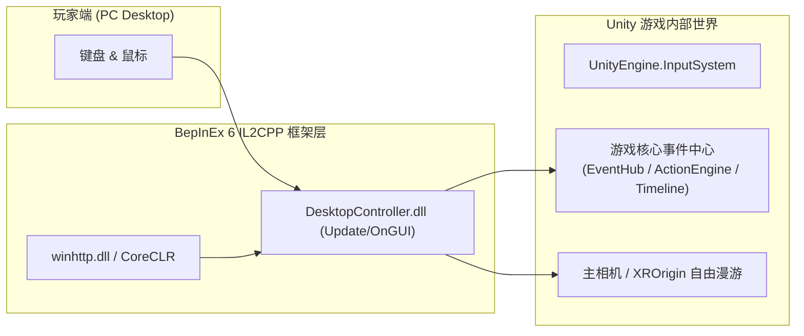

# 针对其他 Unity IL2CPP VR 游戏的快速复用与适配实战指南

本指南旨在为开发者与玩家提供一条**标准化、高复用、免除任何 XR/头显驱动**的通用适配路径，帮助将任意仅支持 VR 手柄的 Unity 游戏平稳转换为键鼠操控的 PC 桌面模式。

---

## 🎯 整体适配架构与核心原理

大部分 Unity VR 游戏在没有检测到头显（如未启动 SteamVR / Oculus 运行时）时，底层的 OpenXR Display 会报错并**自动降级回退到标准的 Windows 2D 桌面窗口渲染**。

游戏无法游玩的核心症结并不在画面，而在于**输入子系统（XR Controller）收不到信号**。通过 BepInEx 6 IL2CPP 注入游戏进程，在主线程 `Update()` 中监听键盘鼠标原生输入，并直接触发游戏内部的手柄响应函数，即可达成“免 XR 模式键鼠操作”。



---

## 🚀 五步极速适配标准化流程

### 第一步：确认游戏架构并部署 BepInEx 6
1. 观察游戏目录：
   - 含有 `GameAssembly.dll` 和 `[游戏名]_Data/il2cpp_data` 即为 **Unity IL2CPP** 架构。
2. 部署 BepInEx 6 IL2CPP (x64)：
   - 解压 BepInEx 6 文件（`winhttp.dll`、`doorstop_config.ini`、`BepInEx/`、`dotnet/`）至游戏根目录。
3. 运行游戏 15~20 秒后关闭：
   - BepInEx 会自动为该游戏分析 `GameAssembly.dll`，在 `BepInEx/interop/` 目录下生成可直接在 C# 中调用的程序集（如 `Assembly-CSharp.dll`、`UnityEngine.CoreModule.dll` 等）。

---

### 第二步：逆向提取游戏事件与控制逻辑
使用项目自带的脚本分析目标游戏的类名与方法：
```bash
python Templates/Scripts/inspect_metadata.py "D:/PathToGame/[Game]_Data/il2cpp_data/Metadata/global-metadata.dat" > game_classes.txt
```
在导出的文本中重点搜索以下高频关键词：
- **事件中心**：`Event`, `Hub`, `Manager`, `Director`, `Engine`, `Action`
- **手柄动作**：`Trigger`, `Grip`, `Stick`, `Primary`, `Recenter`, `Climax`, `Speed`, `Next`
- **UI与相机**：`Menu`, `UI`, `Canvas`, `Camera`, `LookAt`

**经典案例对比**：
* **《精密少女》**：所有操作集中在 `SexEventHub`（如 `OnSpeedChangeRequest`、`OnNextStateRequest`、`OnPreCumSquirt`、`OnQuickMenuToggle` 等静态 Action 委托）。
* **《DragonHVR》**：操作分散在时间线与单例控制器（如 `TimelineLoopAndJump.JumpToC()` 触发高潮、`XRRecenterWithRigidbodies.RecenterToTarget()` 重置视角、`MasterAnimationController.OnSpeedChanged()` 调节速度）。

---

### 第三步：基于通用模板定制插件
复制 `Templates/GenericVRToDesktopPlugin.cs`，根据第二步发现的类和方法填充逻辑：
1. **相机自由旋转与漫游（通用逻辑已预置）**：
   - 鼠标右键按住拖拽：旋转相机父节点 `parentT.Rotate(0f, mouseX, 0f, Space.World)`。
   - `Shift + WASD`：平移摄像机。
2. **手柄按键与功能绑定**：
   - 调速：绑定到 `W/S` 与鼠标滚轮 `mouse.scroll.ReadValue().y`。
   - 核心动作/高潮：绑定到 `Space`（短按/长按）与 `F` 键。
   - 视角重置：绑定到 `R` 键，调用游戏内的 Recenter 方法。
   - 菜单开闭：绑定到 `Tab` 或 `M` 键。

---

### 第四步：编译并部署 DLL
使用提供的 `Templates/build.py` 一键编译：
```bash
python Templates/build.py "D:/PathToGame" "YourPlugin.cs" "YourPlugin.dll"
```
脚本会自动打包相关引用并生成 `.dll` 至目标游戏的 `BepInEx/plugins/` 目录。

---

### 第五步：常见踩坑与解决方案

| 遇到问题 | 根本原因 | 优雅解决方案 |
| :--- | :--- | :--- |
| **`InvalidOperationException: You are trying to read Input using UnityEngine.Input class...`** | Unity PlayerSettings 将输入系统锁定为新版 `Input System Package`，旧版 `UnityEngine.Input` 被引擎主动拒绝。 | **全面采用新版输入系统**：使用 `UnityEngine.InputSystem.Keyboard.current` 与 `Mouse.current` 进行按键捕获。 |
| **画面一直截图保存到桌面** | 某些作者在游戏里挂载了调试截屏脚本（如 `AutoScreenshot`）。 | 在插件 `Start()` 中扫描场景并强制销毁：`Destroy(Object.FindObjectOfType<AutoScreenshot>())`。 |
| **进游戏原本是中文突然变成英文** | BepInEx/CoreCLR 启动导致环境语言重置，Unity 官方本地化模块（`UnityEngine.Localization`）回退为 Invariant/English。 | 在插件 `Start()` 中遍历 `LocalizationSettings.AvailableLocales`，自动锁定匹配 `zh-Hans` / `zh-CN` 并激活。 |
| **视距不在角色跟前，方向歪斜** | VR 原生相机依赖头显定位追踪，PC 下初始可能停留在世界原点 (0,0,0)。 | 在插件初始化 1.5 秒后自动触发一次游戏的 `RecenterView()` / `OnViewResetRequest`。 |
